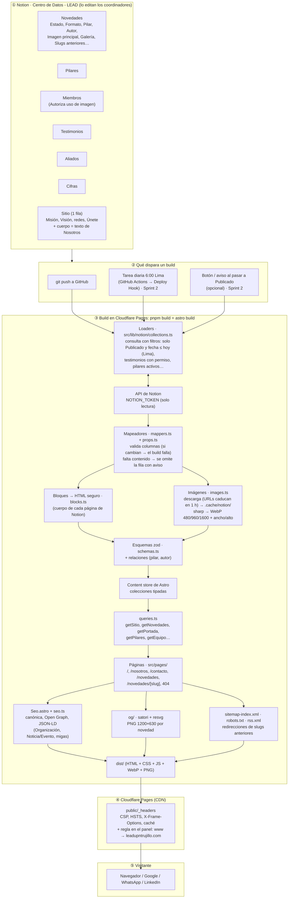

# Cómo funciona la web: Notion → build → Cloudflare Pages → visitante

La web es **estática**: no hay servidor consultando Notion cuando alguien entra. Todo se lee de Notion **una vez, al compilar** (build), y se publica como archivos HTML, imágenes y PNG ya listos. Por eso es rápida, barata y no expone el token de Notion.

## Las capas en una frase

| Capa | Dónde | Qué hace |
|---|---|---|
| Contenido | Notion | El equipo escribe y marca qué se publica. Es la única fuente de verdad. |
| Backend (en build) | `src/lib/notion/` | Lee Notion, valida, aplica las reglas de publicación, convierte el texto a HTML y optimiza las fotos. |
| Datos | `src/content.config.ts`, `src/lib/queries.ts` | Colecciones tipadas; las páginas nunca llaman a Notion. |
| Frontend | `src/pages/`, `src/components/` | Arma el HTML con la línea gráfica de LEAD y el SEO de cada página. |
| Hosting | Cloudflare Pages | Sirve los archivos desde la CDN con los encabezados de seguridad. No hay funciones de servidor (el formulario de contacto se pospuso). |

## Qué pasa cuando alguien publica una novedad

1. En Notion la pasa a **Publicado** y pone la **Fecha de publicación**.
2. En el siguiente build (push, tarea diaria o botón), el loader la trae; si la fecha es futura, espera al build de ese día.
3. Si le falta algo que su formato necesita, se publica igual y el log del build lo avisa.
4. Sus fotos se descargan, se convierten a WebP y se genera su imagen para compartir.
5. Cloudflare Pages publica la versión nueva en uno o dos minutos. Si el build falla, sigue en línea la versión anterior.
